# Laboratório de layouts (protótipos)

Doze propostas visuais para a tela do Android Auto, **só para aprovação**. Nada aqui foi implementado no app: o `app/` continua com os cinco estilos de sempre (`cluster`, `minimal`, `dual`, `grid`, `bars`).

## Como abrir

Dê duplo clique em [`index.html`](index.html) (funciona direto de `file://`, sem servidor e sem internet).

- A galeria mostra as 12 telas rodando ao mesmo tempo, com o mesmo simulador de dados.
- **Clique numa tela** (ou num atalho no topo) para abrir em tela cheia.
- No modo tela cheia: `←` `→` troca de layout, `Esc` fecha.
- O seletor **Cenário** muda o comportamento simulado: normal, cidade, rodovia, esportivo, motor frio, motor quente (ventoinha), falha (P0301) e PID ausente (MAF).
- **Pausar** congela a simulação para comparar telas paradas.

Links diretos para revisar um layout já em movimento:

```
index.html?t=24#radar
index.html?s=fault&t=9#diag
index.html?s=sport&t=9#shift
```

`t=` avança a simulação em segundos antes de desenhar; `s=` escolhe o cenário. No uso normal você não precisa disso.

## Prévia estática

Capturas do modo tela cheia (1920×1080), com a simulação em movimento. Para sentir as animações, abra o `index.html`.

| | | |
|---|---|---|
| 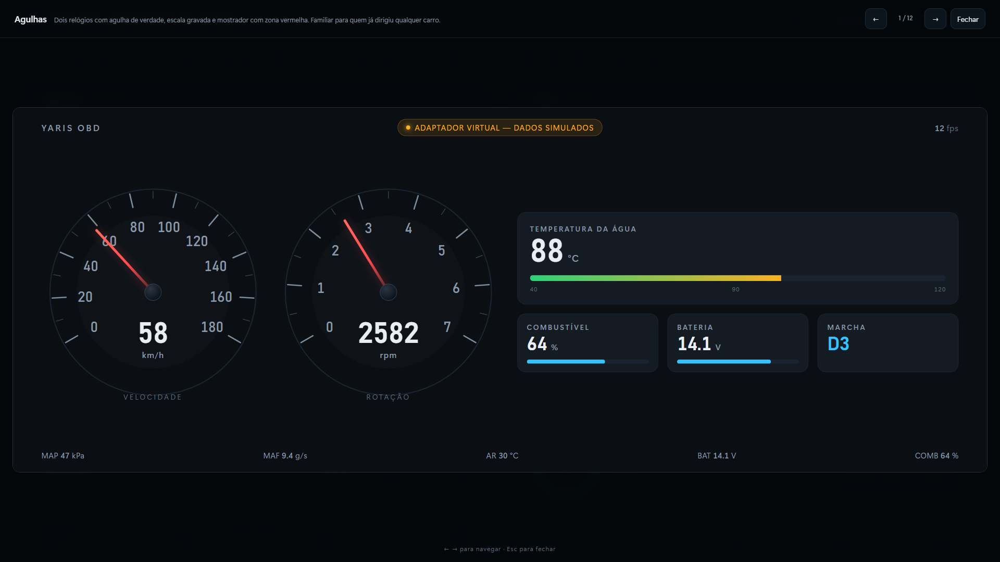 | 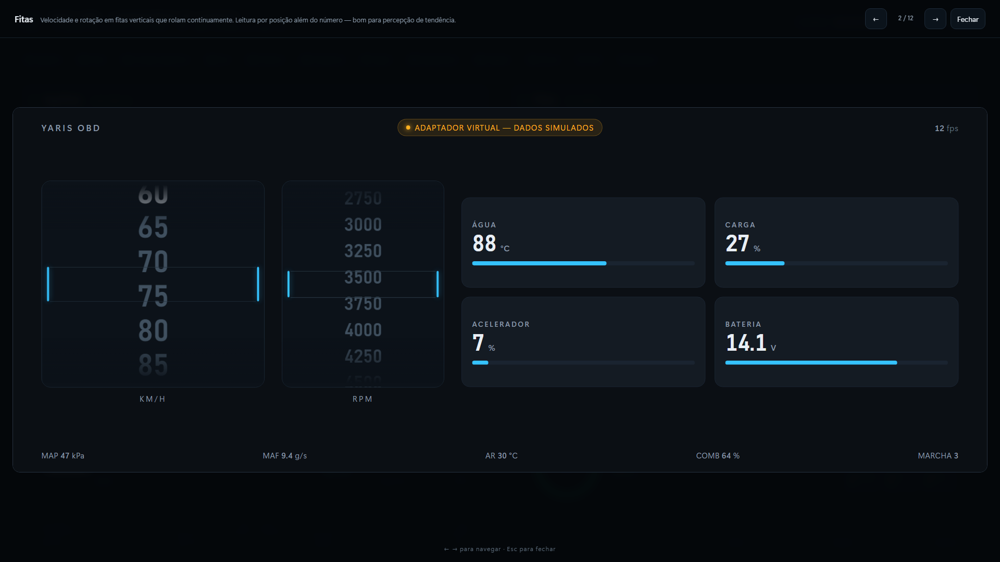 | 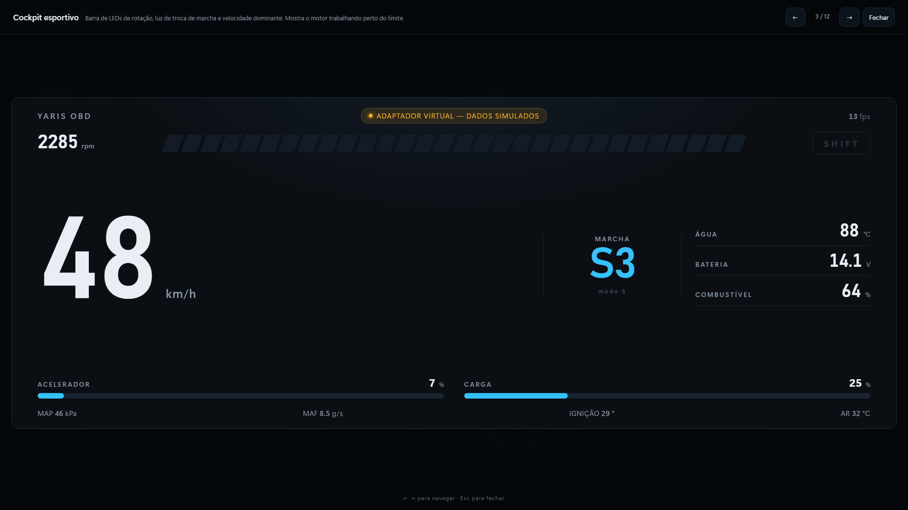 |
| 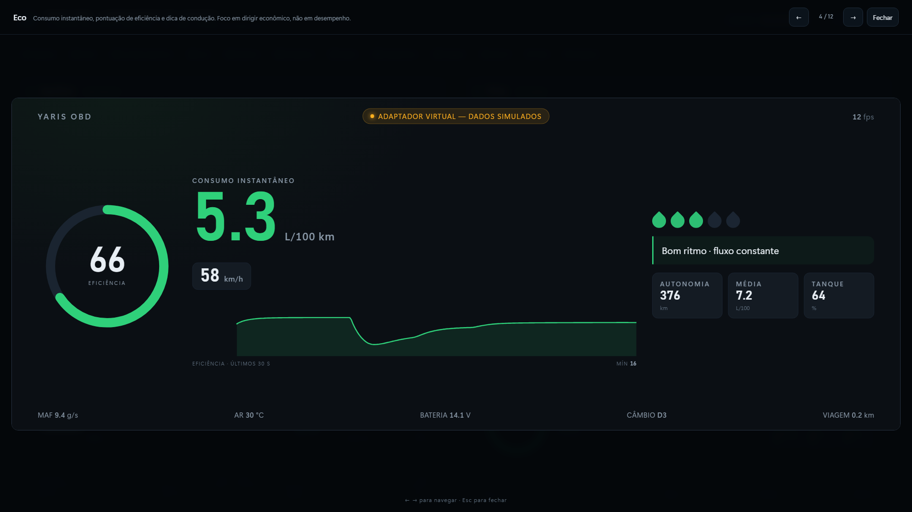 | 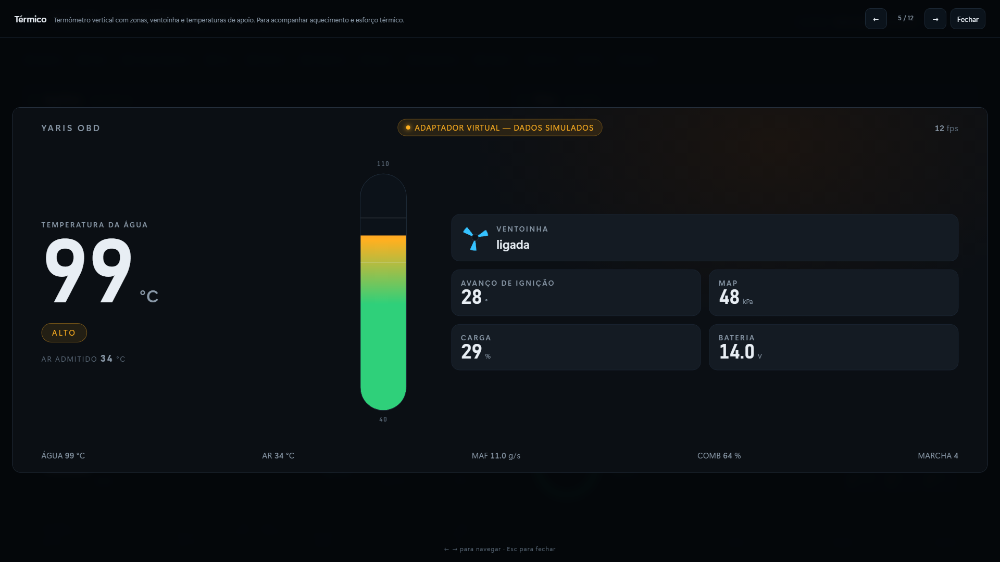 | 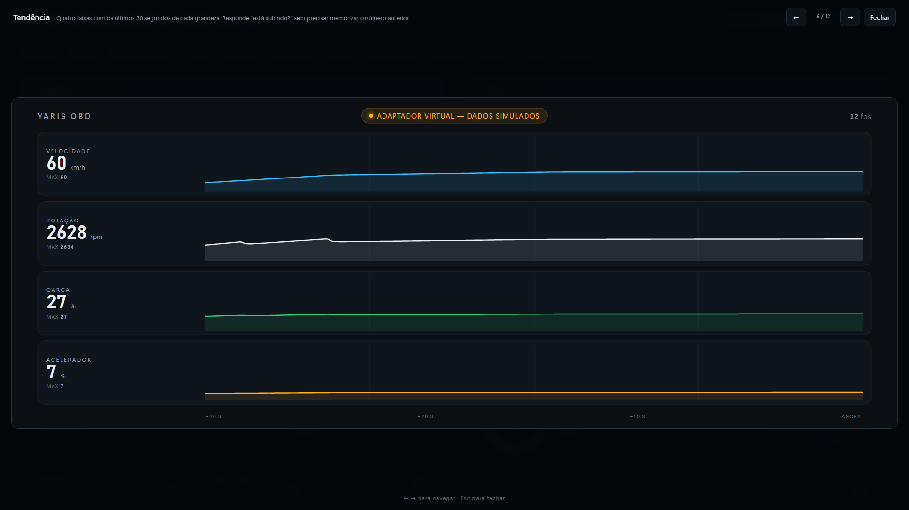 |
| 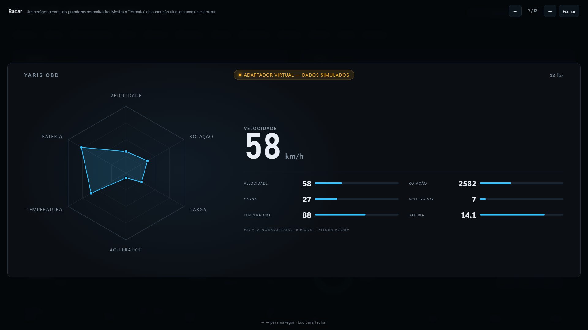 | 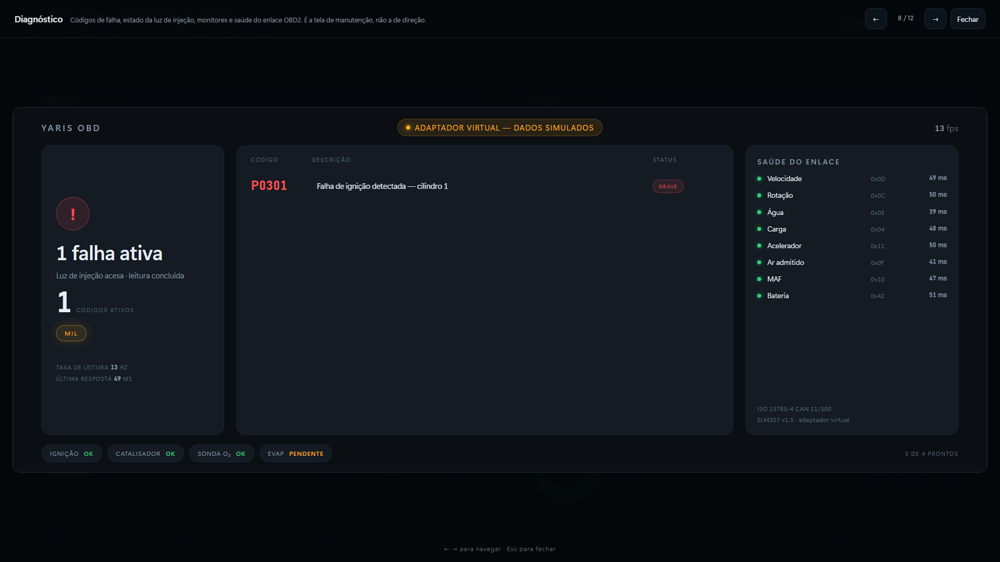 | 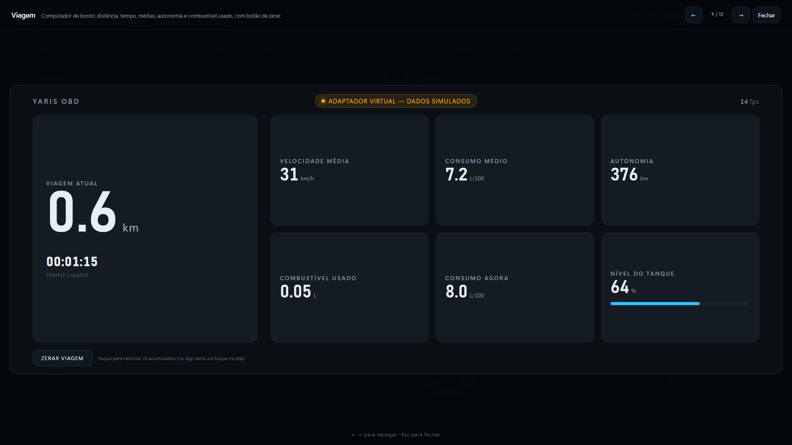 |
| 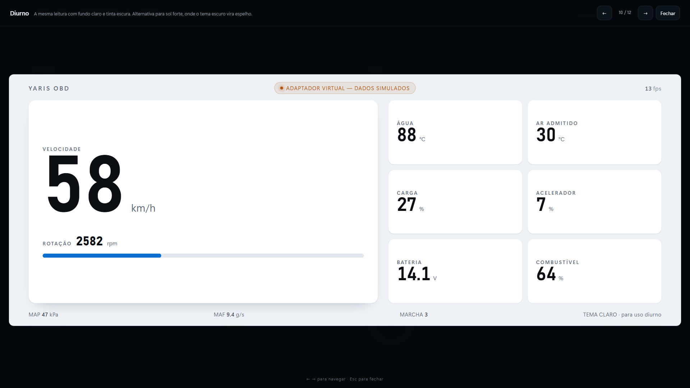 | 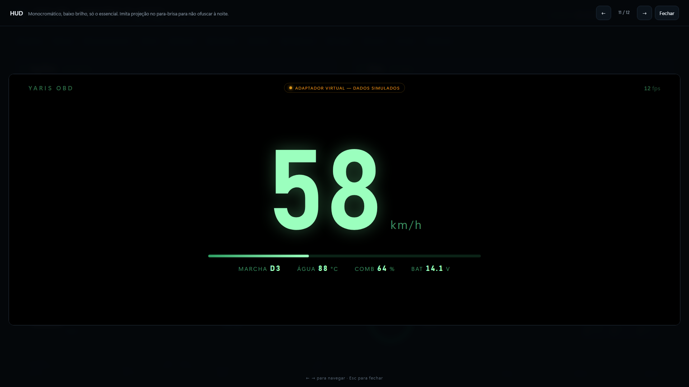 | 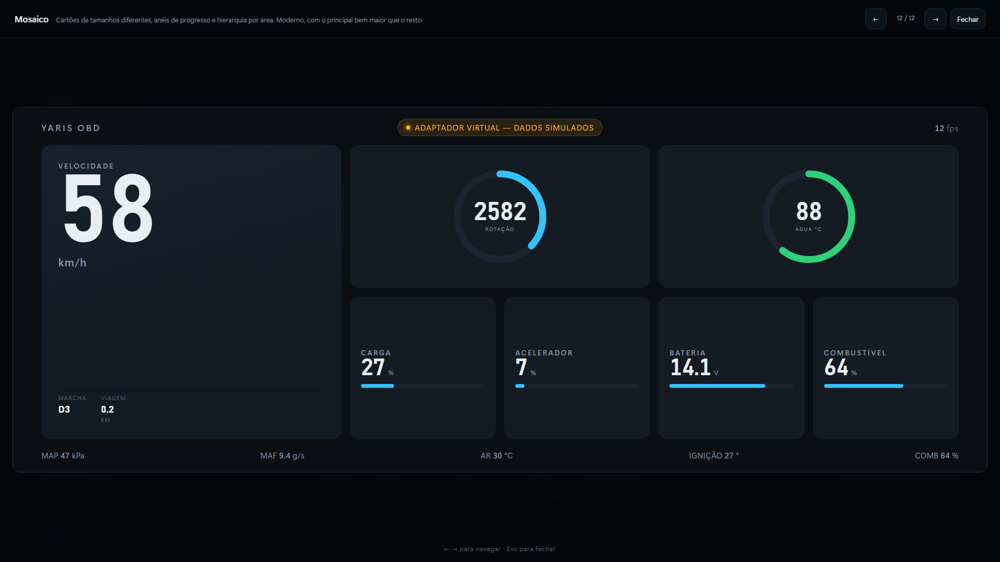 |

Para gerar de novo (Windows, Edge):

```powershell
& "$env:ProgramFiles(x86)\Microsoft\Edge\Application\msedge.exe" --headless=new `
  --window-size=1920,1080 --virtual-time-budget=5000 `
  --screenshot="docs\mockups\preview\04-eco.png" `
  "file:///$((Resolve-Path docs\mockups\index.html).Path -replace '\\','/')?t=27#eco"
```

## As 12 propostas

| # | Layout | Conceito | Para que serve |
|---|---|---|---|
| 01 | **Agulhas** | Dois relógios com agulha de verdade | Familiaridade: parece o painel de um carro comum |
| 02 | **Fitas** | Números rolando em fitas verticais | Ler tendência pela posição, não só pelo número |
| 03 | **Cockpit esportivo** | LEDs de rotação, shift light, marcha | Motor perto do limite, troca de marcha |
| 04 | **Eco** | Consumo, pontuação e dica de condução | Dirigir econômico |
| 05 | **Térmico** | Termômetro com zonas e ventoinha | Aquecimento, esforço térmico |
| 06 | **Tendência** | Sparklines dos últimos 30 s | "Está subindo?" sem comparar de memória |
| 07 | **Radar** | Hexágono de seis grandezas | Visão de conjunto da condução |
| 08 | **Diagnóstico** | DTCs, luz de injeção, monitores, enlace | Manutenção, não direção |
| 09 | **Viagem** | Computador de bordo com médias | Acumulados da viagem |
| 10 | **Diurno** | Tema claro | Sol forte, onde o tema escuro vira espelho |
| 11 | **HUD** | Monocromático, baixo brilho | Noite, projeção no para-brisa |
| 12 | **Mosaico** | Cartões de tamanhos diferentes + anéis | Hierarquia moderna, principal muito maior |

## O que é real e o que é só simulação

- **Real:** proporção 1920×720, paleta, tipografia (dígitos tabulares), hierarquia de leitura, aviso de dados simulados no topo, formatação `—` para indisponível.
- **Simulado:** todos os valores, o aquecimento do motor, a ventoinha, a injeção de falhas, a marcha e o consumo derivado do MAF.

O simulador fica em [`js/sim.js`](js/sim.js) e é só para os mockups. Não tem relação com `VehicleSimulator.kt`.

## O que cada tela respeita (e onde ela arrisca)

As regras de [`docs/estilos-painel.md`](../estilos-painel.md) valem para todas: tema escuro, dígitos tabulares, cor nunca sozinha, `null` nunca vira zero, aviso de simulação sempre visível.

Pontos que merecem decisão sua:

1. **Fitas** e **Térmico** têm movimento contínuo (rolagem e nível). É movimento de dado, não decoração — mas é mais movimento do que os estilos atuais.
2. **Cockpit esportivo** pisca "SHIFT" acima de 6.200 rpm e **HUD** pisca acima de 6.300 rpm. Piscar é o oposto da regra "nada pulsa" — aqui o piscar tem função, mas é decisão de produto.
3. **Diurno** depende de o tema claro ser aceitável no Android Auto em modo noturno. O Android Auto exige suporte a modo escuro; um tema claro fixo quebraria isso.
4. **Miniaturas ficam pequenas.** O mockup escala 1920×720 para o cartão; a leitura boa é no modo tela cheia.
5. **Eco** calcula consumo a partir do MAF (`g/s`) e da speed. Sem MAF suportado, mostra `—` em vez de inventar número (veja o cenário "PID ausente").

## Estrutura

```
docs/mockups/
  index.html        galeria, visualizador e os 12 templates de tela
  css/base.css      tokens, galeria, moldura, cabeçalho/aviso/rodapé comuns
  css/layouts.css   um bloco de CSS por layout
  js/sim.js         simulador de telemetria dos mockups
  js/screens.js     montagem e atualização de cada layout
  js/app.js         galeria, escala, tela cheia, cenários, laço de animação
```

## Se algum for aprovado

O caminho no app é o mesmo de sempre: classe em `render/styles/` estendendo `StyleBase`, `drawBody(...)`, registro em `DashboardStyle` e no `when` de `DashboardRenderer.create(...)`. O mockup mostra quais elementos são texto, qual é forma e qual é cor — que é o que o renderizador precisa saber.

Animações que dependem de estado (agulha, rolagem, brilho de LED) viram cálculo de ângulo/posição no `Canvas`; não existe animação de CSS no app.
